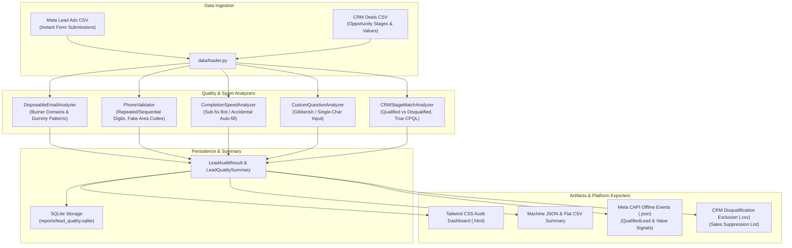

# Meta Lead Quality Analyzer - Technical Architecture

`meta-lead-quality-analyzer` provides a unified diagnostic pipeline connecting Meta Instant Forms with CRM sales stages to compute accurate Cost-Per-Qualified-Lead (CPQL) metrics and automate CAPI offline value optimization.

---

## 1. Pipeline Flow

---

## 2. Core Economic Metric Formulas

### Front-End Cost Per Lead (CPL)
$$\text{Front-End CPL} = \frac{\sum \text{Meta Ad Spend}}{\text{Total Raw Leads}}$$

### True Cost Per Qualified Lead (CPQL)
$$\text{True CPQL} = \frac{\sum \text{Meta Ad Spend}}{\text{Total Sales-Qualified Leads}}$$

### Junk Lead Rate
$$\text{Junk Rate} = \frac{\text{Total Disqualified Leads (Spam Email, Fake Phone, Bot Speed)}}{\text{Total Leads}} \times 100\%$$
